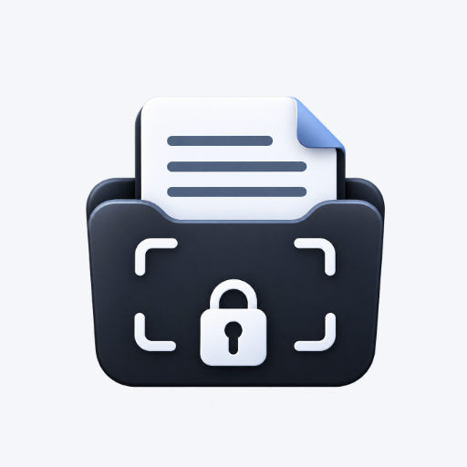
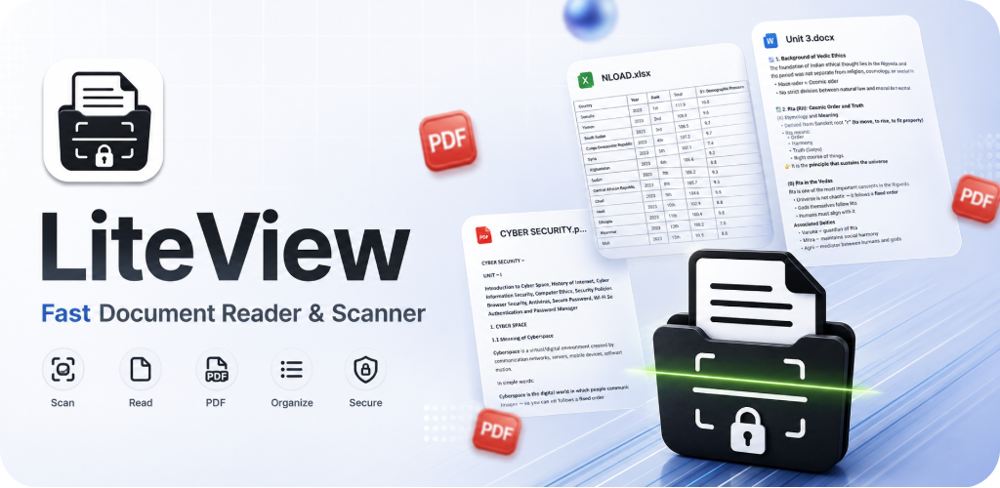
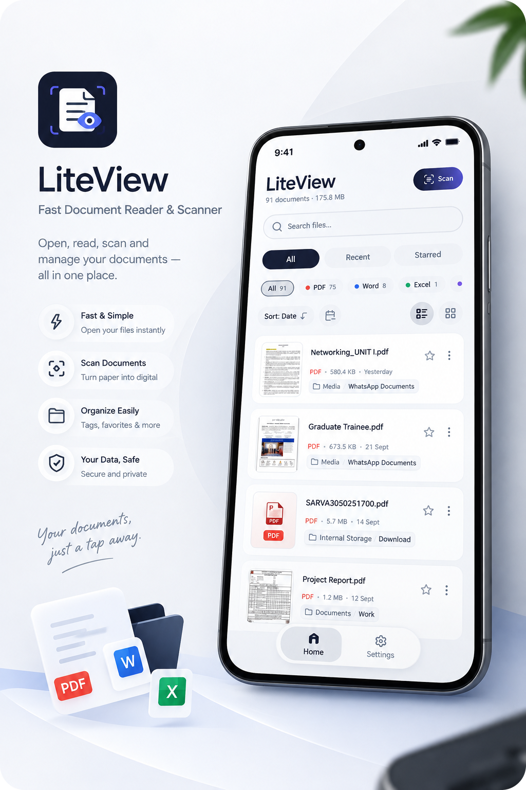
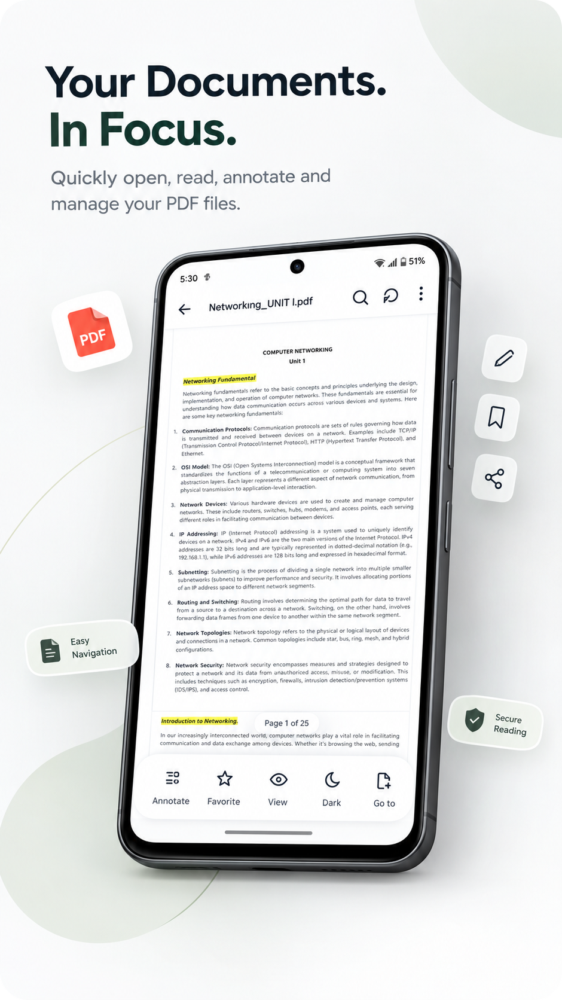
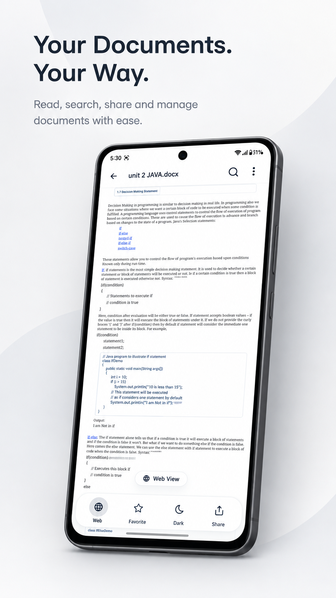
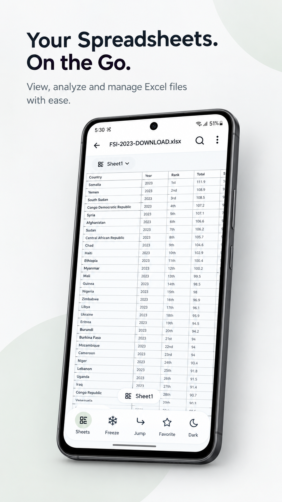

<div align="center">


<a href="https://play.google.com/store/apps/details?id=com.nexus.nexusdocs"></a>


</div>

---

<div align="center">



</div>

---

<div align="center">



</div>

---

<div align="center">

# LiteView — Document Viewer, Scanner & Annotation Suite

**A fast, elegant, and feature-rich Android document reader & annotation workspace.**
View PDFs, Office files, PowerPoint presentations, and text documents. Annotate PDFs with stamps, text boxes, and precision measurement rulers. Scan physical documents directly with your camera.

<br/>

<a href="https://play.google.com/store/apps/details?id=com.nexus.nexusdocs" target="_blank">
  
</a>

</div>

---

## ✨ Key Features

| Feature | Description |
|---|---|
| 📑 **PDF Reader & Viewer** | High-fidelity PDF rendering powered by **MuPDF 1.23** with page rotation, night modes, and search |
| 🧲 **Edge-Docking Toolbar** | Modular floating PDF toolbar with 4-edge smart snapping (**Left**, **Right**, **Top**, **Bottom**) and avatar mode |
| ✍️ **PDF Annotation Suite** | Rich annotation tools including Pen, Translucent Highlighter, Shapes (Rectangles, Ovals, Lines, Arrows) |
| 📝 **Free Text & Stamps** | Single-tap Free Text box insertion and 1-tap Business Stamps (**APPROVED**, **CONFIDENTIAL**, **DRAFT**, **FINAL**, **REJECTED**, **SIGN HERE**) |
| 📏 **Distance Measurement** | Precision blueprint ruler rendering end ticks and calculating live distance in centimeters (`%.1f cm`) |
| 🧹 **Target-Filtered Eraser** | Intelligent eraser engine supporting `Erase All`, `Pen Only`, `Highlighter Only`, and `Shapes Only` filter modes |
| 📽️ **PowerPoint Viewer (PPT/PPTX)** | Fast offline slide presentation reader with fullscreen present mode, thumbnail drawer, and dual-engine POI + LOKit bridge |
| 📊 **Word & Excel Suite** | View `.docx` and `.xlsx` documents via **Apache POI** with dark mode, freeze panes, and jump-to-cell |
| 📝 **Code & Text Viewer** | Clean and readable plain text file reader with syntax highlighting and word wrap toggles |
| 📸 **Document Scanner** | Scan physical pages to PDF or JPEG via **ML Kit Document Scanner** |
| 🔍 **OCR (Text Recognition)** | Extract text from scanned images using **ML Kit Text Recognition** |
| ⭐ **Universal Favorites** | Pin your most-used documents with instant gold star indicators across all reader toolbars |
| 📂 **Auto-Recording Recents** | Opening documents via SAF pickers or external intents auto-registers them in the Recent tab |
| 🎨 **Glassmorphic UI** | Luxury frosted glass surfaces, custom floating pill toolbars, and spring-animated micro-interactions |
| 🗂️ **Smart Dashboard** | View All, Recent, and Starred files with real-time list sync, sorting, and search |
| 🔲 **Multi-Select Actions** | Long-press to select multiple files, then share or delete them in bulk |
| 🏷️ **Tag System** | Create custom color + emoji tags, filter the dashboard by tag, and manage all tags in the Tag Library |
| 🗑️ **Permanent File Delete & Trash** | Safe file deletion with 10-second undo countdown and Recycle Bin management |
| 🌓 **Dark & Light Mode** | Full system theme support, AMOLED Deep Black, and reader background modes |
| 🔄 **In-App Updater** | Checks for new releases via GitHub REST API with session dismissal memory & in-app APK installer |
| 🔃 **Pull to Refresh** | Swipe down to re-scan the file system for new documents |

---

## 📱 Screenshots

<div align="center">

| Home & Dashboard | PDF Reader & Annotations |
|:---:|:---:|
|  |  |
| *Smart file list, search, tags & recent history* | *High-fidelity viewer with edge-docked annotations* |

| Word (DOCX) Reader | Excel (XLSX) Sheets |
|:---:|:---:|
|  |  |
| *Clean typographic layout with mobile view* | *Full spreadsheet grid with formula & sheet navigation* |

</div>

---

## 🏗️ Architecture & Tech Stack

LiteView is built with a clean, scalable, multi-module architecture following **MVVM** and **Clean Architecture** principles.

### Module Structure

```
NexusDocsViewer/
├── app/                      # Application entry point, DI graph, Navigation host
├── core/                     # Shared UI design system, theme, navigation contracts, database
└── feature/
    ├── dashboard/            # Home screen, Recent/Starred/All file lists, Settings, Trash, Tags
    ├── reader-pdf/           # MuPDF PDF experience, annotation engine, edge-docking toolbar
    ├── reader-office/        # Apache POI Office document viewer (.docx, .xlsx)
    ├── reader-presentation/  # PowerPoint (.pptx, .ppt) viewer, LOKit NDK bridge, POI parser
    ├── reader-text/          # Plain text file reader with syntax highlighting
    └── scanner/              # ML Kit document scanning & OCR
```

### 🧭 Architecture Flowchart & Mindmap

```mermaid
%% Generated by https://gitdiagram.com/manish-sherawat/liteview
flowchart TD

subgraph group_app["App and navigation"]
  node_activity["App entry<br/>[MainActivity.kt]"]
  node_navhost["Navigation host<br/>[NexusNavHost.kt]"]
  node_router["Reader router"]
end

subgraph group_workspace["Document workspace"]
  node_dashboard["Dashboard<br/>[DashboardScreen.kt]"]
  node_scan["Storage scanning"]
  node_fileops["File operations"]
  node_history["Recents and tags"]
  node_trash["Trash management<br/>[TrashRepository.kt]"]
  node_tagui["Tag library"]
  node_tools["PDF conversion tools<br/>[ToolsScreen.kt]"]
  node_database[("Room database<br/>[NexusDatabase.kt]")]
end

subgraph group_readers["Document readers"]
  node_pdf["PDF reader<br/>[PdfReaderScreen.kt]"]
  node_annotation["PDF annotations"]
  node_office["Office reader"]
  node_presentation["Presentation reader"]
  node_presentationengine["Presentation engines<br/>[LOKitManager.kt]"]
  node_text["Text reader"]
end

subgraph group_capture["Scanning and tools"]
  node_scanner["Document scanner<br/>[ScannerScreen.kt]"]
  node_pdfgen["PDF generation<br/>[PdfGenerator.kt]"]
end

subgraph group_shared["Shared services"]
  node_preferences[("User preferences")]
  node_theme["Design system<br/>[NexusTheme.kt]"]
  node_updater["In-app updater"]
end

node_user(("User"))
node_github{{"GitHub releases"}}
node_mlkit{{"ML Kit scanner and OCR"}}

node_user -->|"opens"| node_activity
node_activity -->|"starts"| node_navhost
node_navhost -->|"routes documents"| node_router
node_user -->|"browses files"| node_dashboard
node_dashboard -->|"refreshes listing"| node_scan
node_dashboard -->|"acts on files"| node_fileops
node_dashboard -->|"shows recents"| node_history
node_dashboard -->|"opens recycle bin"| node_trash
node_dashboard -->|"manages tags"| node_tagui
node_dashboard -->|"offers tools"| node_tools
node_history -->|"persists records"| node_database
node_trash -->|"stores trash records"| node_database
node_router -->|"routes PDF"| node_pdf
node_router -->|"routes slides"| node_presentation
node_router -->|"routes text"| node_text
node_router -.->|"routes Office"| node_office
node_pdf -->|"uses toolbar"| node_annotation
node_presentation -->|"renders slides"| node_presentationengine
node_user -->|"scans pages"| node_scanner
node_scanner -.->|"exports PDF"| node_pdfgen
node_scanner -->|"uses scanning OCR"| node_mlkit
node_user -->|"sets preferences"| node_preferences
node_preferences -.->|"supplies theme mode"| node_theme
node_updater -->|"checks releases"| node_github

click node_activity "https://github.com/manish-sherawat/liteview/blob/main/app/src/main/kotlin/com/nexus/nexusdocs/MainActivity.kt"
click node_navhost "https://github.com/manish-sherawat/liteview/blob/main/app/src/main/kotlin/com/nexus/nexusdocs/navigation/NexusNavHost.kt"
click node_router "https://github.com/manish-sherawat/liteview/blob/main/app/src/main/kotlin/com/nexus/nexusdocs/navigation/DocumentReaderRouterImpl.kt"
click node_dashboard "https://github.com/manish-sherawat/liteview/blob/main/feature/dashboard/src/main/kotlin/com/nexus/feature/dashboard/DashboardScreen.kt"
click node_scan "https://github.com/manish-sherawat/liteview/blob/main/feature/dashboard/src/main/kotlin/com/nexus/feature/dashboard/domain/StorageScanUseCase.kt"
click node_fileops "https://github.com/manish-sherawat/liteview/blob/main/feature/dashboard/src/main/kotlin/com/nexus/feature/dashboard/domain/FileOperationUseCase.kt"
click node_history "https://github.com/manish-sherawat/liteview/blob/main/feature/dashboard/src/main/kotlin/com/nexus/feature/dashboard/data/RecentDocumentRepository.kt"
click node_trash "https://github.com/manish-sherawat/liteview/blob/main/feature/dashboard/src/main/kotlin/com/nexus/feature/dashboard/data/TrashRepository.kt"
click node_tagui "https://github.com/manish-sherawat/liteview/blob/main/feature/dashboard/src/main/kotlin/com/nexus/feature/dashboard/TagManagerScreen.kt"
click node_tools "https://github.com/manish-sherawat/liteview/blob/main/feature/dashboard/src/main/kotlin/com/nexus/feature/dashboard/ToolsScreen.kt"
click node_database "https://github.com/manish-sherawat/liteview/blob/main/feature/dashboard/src/main/kotlin/com/nexus/feature/dashboard/data/NexusDatabase.kt"
click node_pdf "https://github.com/manish-sherawat/liteview/blob/main/feature/reader-pdf/src/main/kotlin/com/nexus/feature/reader/pdf/PdfReaderScreen.kt"
click node_annotation "https://github.com/manish-sherawat/liteview/blob/main/feature/reader-pdf/src/main/kotlin/com/nexus/feature/reader/pdf/components/PdfAnnotationToolbar.kt"
click node_office "https://github.com/manish-sherawat/liteview/blob/main/feature/reader-office/src/main/kotlin/com/nexus/feature/reader/office/OfficeReaderScreen.kt"
click node_presentation "https://github.com/manish-sherawat/liteview/blob/main/feature/reader-presentation/src/main/kotlin/com/nexus/feature/reader/presentation/ui/PresentationReaderScreen.kt"
click node_presentationengine "https://github.com/manish-sherawat/liteview/blob/main/feature/reader-presentation/src/main/kotlin/com/nexus/feature/reader/presentation/engine/LOKitManager.kt"
click node_text "https://github.com/manish-sherawat/liteview/blob/main/feature/reader-text/src/main/kotlin/com/nexus/feature/reader/text/TextReaderScreen.kt"
click node_scanner "https://github.com/manish-sherawat/liteview/blob/main/feature/scanner/src/main/kotlin/com/nexus/feature/scanner/ui/ScannerScreen.kt"
click node_pdfgen "https://github.com/manish-sherawat/liteview/blob/main/feature/scanner/src/main/kotlin/com/nexus/feature/scanner/utils/PdfGenerator.kt"
click node_preferences "https://github.com/manish-sherawat/liteview/blob/main/core/src/main/kotlin/com/nexus/core/preferences/UserPreferencesRepository.kt"
click node_theme "https://github.com/manish-sherawat/liteview/blob/main/core/src/main/kotlin/com/nexus/core/theme/NexusTheme.kt"
click node_updater "https://github.com/manish-sherawat/liteview/tree/main/feature/dashboard/src/main/kotlin/com/nexus/feature/dashboard"

classDef toneNeutral fill:#f8fafc,stroke:#334155,stroke-width:1.5px,color:#0f172a
classDef toneBlue fill:#dbeafe,stroke:#2563eb,stroke-width:1.5px,color:#172554
classDef toneAmber fill:#fef3c7,stroke:#d97706,stroke-width:1.5px,color:#78350f
classDef toneMint fill:#dcfce7,stroke:#16a34a,stroke-width:1.5px,color:#14532d
classDef toneRose fill:#ffe4e6,stroke:#e11d48,stroke-width:1.5px,color:#881337
classDef toneIndigo fill:#e0e7ff,stroke:#4f46e5,stroke-width:1.5px,color:#312e81
classDef toneTeal fill:#ccfbf1,stroke:#0f766e,stroke-width:1.5px,color:#134e4a
class node_activity,node_navhost,node_router,node_user toneBlue
class node_dashboard,node_scan,node_fileops,node_history,node_trash,node_tagui,node_tools,node_database toneAmber
class node_pdf,node_annotation,node_office,node_presentation,node_presentationengine,node_text toneMint
class node_scanner,node_pdfgen toneRose
class node_preferences,node_theme,node_updater,node_github,node_mlkit toneIndigo
```



### 🏛️ Architectural Principles

LiteView follows Google's recommended Modern Android Architecture (MVI / MVVM with Clean Architecture):

- **Unidirectional Data Flow (UDF)** — State flows down via immutable Kotlin Coroutines `StateFlow`, while user actions flow up through typed UI events.
- **Strict Multi-Module Decoupling** — Feature modules (`feature:reader-pdf`, `feature:reader-presentation`, etc.) never depend on each other. Navigation and reader launches are resolved via the `DocumentReaderRouter` interface in `:core`.
- **Hybrid High-Performance Rendering** — Pairs native C/C++ NDK engines (MuPDF 1.23 and LibreOfficeKit) for high-speed document rasterization with Jetpack Compose Canvas overlays for smooth vector drawing, annotations, and blueprint measurement.
- **Offline-First & Zero-Telemetry** — 100% on-device local storage (Room SQLite + DataStore), ML Kit on-device models, and privacy-respecting offline document manipulation.

### 🛠️ Tech Stack

| Layer | Library / Tool | Version | Purpose & Details |
|---|---|---|---|
| **Language** | Kotlin | `2.0.21` | Modern, concise, null-safe language targeting JVM 17 |
| **Compiler & Codegen** | Kotlin KSP | `2.0.21-1.0.28` | High-performance annotation processing for Room & Hilt |
| **Build System** | Android Gradle Plugin (AGP) | `8.10.0` | Multi-module build optimization and R8 resource shrinking |
| **UI Toolkit** | Jetpack Compose | BOM `2025.06.00` | Declarative UI framework with Material Design 3 |
| **Glassmorphism** | ChrisBanes Haze | `1.3.0` | Hardware-accelerated frosted glass backdrop blurs |
| **Dependency Injection** | Dagger Hilt | `2.55` | Compile-time dependency injection across modules |
| **Navigation** | Navigation Compose | `2.8.5` | Type-safe declarative in-app navigation routes |
| **Database & Cache** | Room SQLite | `2.6.1` | Local persistence for recents, custom tags & trash history |
| **Preferences** | DataStore Preferences | `1.1.1` | Asynchronous key-value user preferences storage |
| **Concurrency & Async** | Coroutines & Flow | `1.9.0` | Reactive state management with `StateFlow` and structured concurrency |
| **Lifecycle** | AndroidX Lifecycle | `2.8.7` | `collectAsStateWithLifecycle` & ViewModel lifecycle scopes |
| **PDF Engine** | MuPDF (fitz) | `1.23.0` | Ultra-fast native C/C++ vector PDF rasterization engine |
| **PDF Tooling** | PDFBox-Android | `2.0.27.0` | Blueprint scale calculations and PDF document utilities |
| **Office Suite Parser** | Apache POI | `5.2.5` | Offline DOCX, XLSX, and PPTX document parsing (`aalto-xml 1.3.2`) |
| **Presentation Engine** | LibreOfficeKit Bridge | Native NDK | C++ JNI bridge (`libnexus_presentation_engine.so`) for desktop slide fidelity |
| **Vision & ML** | Google ML Kit | `16.0.0` / `19.0.0` | Document Scanner edge detection & on-device Text OCR |
| **Image Loading** | Coil | `3.0.0` | High-performance image loading, thumbnail caching & SVG support |
| **Animations** | Jetpack Compose + Lottie | `6.6.2` | Spring-physics micro-interactions and vector animations |
| **Permissions** | Accompanist Permissions | `0.36.0` | Seamless runtime storage and camera permission management |


---

## 🚀 Getting Started

<div align="center">

<a href="https://play.google.com/store/apps/details?id=com.nexus.nexusdocs" target="_blank">
  
</a>

</div>

### Prerequisites

- **Android Studio** Hedgehog (2023.1.1) or newer
- **JDK 17**
- **Android SDK** with API Level 26+ installed
- **Android NDK** (version 25+ recommended) for native C++ bridge compilation

### Cloning & Running

```bash
# 1. Clone the repository
git clone https://github.com/manish-sherawat/LiteView.git

# 2. Open the project in Android Studio
# (File -> Open -> select the NexusDocsViewer folder)

# 3. Let Gradle sync finish

# 4. Run the app on a device or emulator (API 26+)
```

### Building a Release APK

```bash
# From the project root
./gradlew assembleRelease

# The signed APK will be located at:
# app/build/outputs/apk/release/app-release.apk
```

---

## 📁 Project Deep Dive

### `core` Module

The foundation of the app. Contains:
- **`NexusTheme`** — Custom design system (colors, typography, shapes, spacing)
- **`NexusComponents`** — Reusable UI components (`NexusSurface`, `NexusText`, `NexusButton`, `NexusTopBar`, `NexusCollapsingTopBar`, etc.)
- **`NexusBottomNav`** — Custom animated bottom navigation bar
- **`navigation/`** — Navigation contracts, `DocumentReaderRouter`, `DocumentType` enum
- **`preferences/`** — `UserPreferencesRepository` (DataStore-backed user settings)

### `feature/dashboard` Module

The main home screen workspace. Contains:
- **`DashboardScreen`** — File list (All / Recent / Starred tabs), search, sort, pull-to-refresh
- **`DashboardViewModel`** — Manages UI state, file scanning, multi-select mode
- **`FileListItem` & `FileGridItem`** — Animated file card components with high-res thumbnails
- **`FileOptionsDialog`** — Contextual action sheet (Share, Rename, Star, Details, Delete)
- **`RecycleBinScreen`** — Trash and file recovery management
- **`TagManagerScreen`** — Custom color and emoji tag categorization
- **`ToolsScreen`** — Built-in PDF tools (Images to PDF, Word to PDF)
- **`SettingsScreen`** — App settings, cache management, AMOLED mode, changelog viewer

### `feature/reader-pdf` Module

Full-featured PDF reader powered by **MuPDF**:
- **Smart Edge Drag-Docking Toolbar** (`PdfAnnotationPill`) — Snap to 4 screen edges with avatar collapse mode
- **Annotation Canvas Overlay** — Pen, Translucent Highlighter, Shapes (Rectangles, Ovals, Lines, Arrows)
- **Free Text Box & Business Stamps** — Interactive text dialogs and 1-tap review badges
- **Distance Measurement Ruler** — Real-time blueprint scale calculation in centimeters (`%.1f cm`)
- **Target-Filtered Eraser** — Filter modes (`Erase All`, `Pen Only`, `Highlighter Only`, `Shapes Only`)
- Page rotation synchronization (90°, 180°, 270°)
- Scroll position persistence and PDF thumbnail caching

### `feature/reader-presentation` Module

PowerPoint (`.pptx` & `.ppt`) presentation reader:
- **Zero-AWT Apache POI Parser** — Offline presentation parser extracting slides, titles, bullets, tables, and images without runtime crashes
- **Native LibreOfficeKit Bridge** — C++ JNI bridge (`libnexus_presentation_engine.so`) ready for precompiled LOKit desktop rendering
- **Luxury Presenter UI** — Floating slide badge, jump-to-slide dialog, bottom dock toolbar, thumbnail drawer, pinch/double-tap zoom, and fullscreen presentation mode

### `feature/reader-office` Module

Office document reader using **Apache POI**:
- Supports `.docx` and `.xlsx` formats
- Renders Word documents in a responsive HTML WebView with Dark Mode adaptation
- Renders Excel spreadsheets with interactive freeze panes, sheet tab switching, and cell jumping

### `feature/reader-text` Module

Plain text and source code viewer:
- Fast rendering of `.txt` files with line numbering and syntax highlighting
- Configurable word wrap and font scaling

### `feature/scanner` Module

Physical document scanning powered by **Google ML Kit**:
- Automatic edge detection, perspective correction, and image filters
- Saves output as **PDF** or **JPEG**
- OCR text extraction from scanned images using `TextRecognition`

---

## 🎨 Design System

LiteView uses a bespoke design language called **Nexus Design System**, implemented entirely in Jetpack Compose:

- **Glassmorphism** — Frosted glass effect on floating UI surfaces (multi-select action bar, floating snackbars, bottom docks)
- **Shared Element Transitions** — Hero animations from file card thumbnail to full reader
- **Spring-Based Micro-Interactions** — Bouncy, responsive press animations (`springBounceClick`) on all interactive elements
- **AMOLED Dark Mode** — Pitch-black dark mode for OLED displays
- **Document Accent Colors** — Each file type (PDF, DOCX, XLSX, PPTX, TXT) has its own curated accent color

---

## 🗺️ Roadmap & Milestones

See the detailed engineering documentation in the `docs/` folder:
- **[PPT_VIEWER_ROADMAP.md](docs/PPT_VIEWER_ROADMAP.md)** — Architectural roadmap for PowerPoint rendering, vector graphics, and presentation tools
- **[PPT_VIEWER_TASKS.md](docs/PPT_VIEWER_TASKS.md)** — Step-by-step engineering task tracker

### ✅ Completed Milestones
- [x] **v3.2.0** — **PowerPoint (`.pptx` / `.ppt`) Viewer** (Zero-AWT POI parser, native LOKit NDK bridge, luxury floating dock, jump-to-slide, thumbnail drawer, fullscreen present mode)
- [x] **v3.1.0** — **Recycle Bin & Safe Delete** (Soft-delete with 10-second undo countdown, trash restoration, permanent shredding)
- [x] **v3.0.3** — **Tag Library & Organization** (Custom color & emoji tags, dashboard category filters, bulk tag assignment)
- [x] **v3.0.0** — **PDF Measurement & Blueprint Tools** (Live distance ruler in cm, 1-tap business stamps, target-filtered eraser)
- [x] **v2.9.0** — **Universal Starred & Recent Sync** (SAF & external intent auto-recording, synchronized gold star status across all readers)
- [x] **v2.8.0** — **In-App Updater & Multi-Select** (GitHub Release asset checks, direct APK installation, bulk sharing and batch deletion)

### 🚀 Planned & In Progress
- [ ] **Presentation In-Slide Text Search** — Live search query highlighting across slide titles and body text
- [ ] **Speaker Notes Drawer for PPTX** — Expandable bottom sheet displaying slide notes and presenter cues
- [ ] **Slide Export Suite** — Convert presentation decks into multi-page PDF or individual high-resolution PNG slides
- [ ] **Vector AutoShape Rendering** — Native Compose Canvas drawing for PowerPoint callouts, flowcharts, and geometric connectors
- [ ] **AI Document Copilot** — On-device / hybrid Gemini API integration for document summarization, key takeaway extraction, and interactive Q&A
- [ ] **Cloud Storage Hub** — Direct integration with Google Drive, Nextcloud, and Dropbox for seamless document synchronization


---

## 📄 License

This project is licensed under the **MIT License** — see the [LICENSE](LICENSE) file for details.

---

<div align="center">

<a href="https://play.google.com/store/apps/details?id=com.nexus.nexusdocs" target="_blank">
  
</a>

<br/><br/>

Made with ❤️ by **Manish Sherawat**

**[GitHub](https://github.com/manish-sherawat) · [Report a Bug](https://github.com/manish-sherawat/LiteView/issues) · [Request a Feature](https://github.com/manish-sherawat/LiteView/issues)**

</div>
