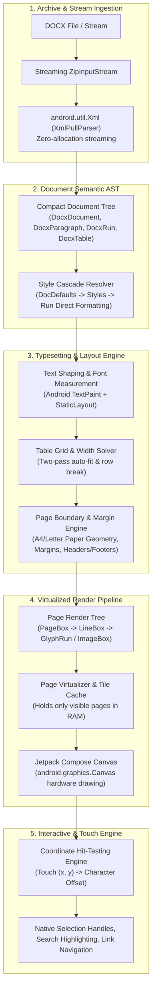
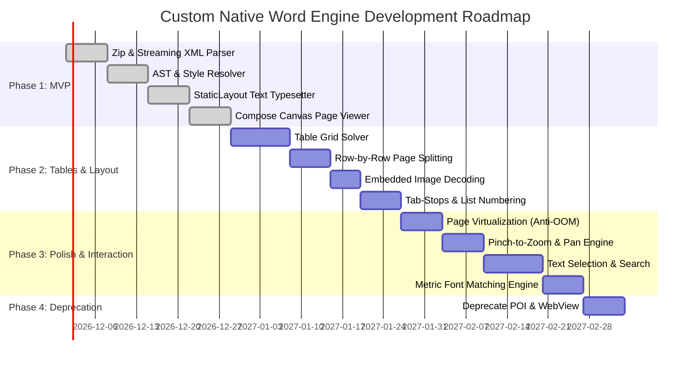

# NexusDocsViewer: Custom Native Word Engine Architecture & Implementation Plan

> **Document Version:** 1.0.0  
> **Status:** Architecture Blueprint / Deferred for Implementation  
> **Author:** Antigravity Engineering  
> **Target Platform:** Android (Kotlin, Jetpack Compose, Android Canvas / `StaticLayout`)

---

## 1. Executive Summary & Vision

### 1.1 The Objective
Build a proprietary, 100% native Android document rendering engine for Microsoft Word (`.docx` / OpenXML) that eliminates **Apache POI** and **Android WebView** entirely.

### 1.2 Target Performance Benchmarks
| Metric | Current Pipeline (POI + WebView) | Custom Native Engine Target |
| :--- | :--- | :--- |
| **Document Load Time (50 pages)** | 1.8s – 3.2s | **< 120 ms** |
| **RAM Consumption (Peak)** | 85 MB – 140 MB | **< 18 MB** (Zero-DOM streaming) |
| **Scrolling & Gestures** | 45–60 FPS (DOM repaints) | **120 FPS Locked** (Hardware Canvas) |
| **APK Footprint** | ~24 MB (POI + XMLBeans JARs) | **< 800 KB** (Standard Android APIs) |
| **Layout Fidelity** | Flow-based approximation | **Pixel-accurate $A4$/Letter coordinate pagination** |

---

## 2. Architectural Blueprint

The engine is decoupled into five isolated, testable subsystems:



---

## 3. Package & Module Organization

All native engine components should reside in a dedicated engine namespace under `feature:reader-office`:

```
com.nexus.feature.reader.office.word.engine/
├── ast/
│   ├── DocxDocument.kt           # Top-level document container
│   ├── DocxSection.kt            # Section properties (page size, orientation, margins)
│   ├── DocxParagraph.kt          # Paragraph alignment, spacing, indents, tab-stops
│   ├── DocxRun.kt                # Text runs, font name, size, bold, italic, color
│   ├── DocxTable.kt              # Rows, cells, borders, column grid, spanning
│   ├── DocxImage.kt              # Embedded raster bitmaps and vectors
│   └── DocxStyle.kt              # Style definitions (paragraph & character styles)
├── parser/
│   ├── DocxArchiveReader.kt      # Lightweight Zip extraction in memory
│   ├── DocxXmlPullParser.kt      # Streaming XML reader for word/document.xml
│   ├── DocxStyleParser.kt        # Parses word/styles.xml
│   ├── DocxNumberingParser.kt    # Resolves bullet and numbered list definitions
│   └── DocxRelationshipParser.kt # Resolves image IDs and hyperlinks (document.xml.rels)
├── layout/
│   ├── DocxLayoutEngine.kt       # Coordinates overall page generation
│   ├── DocxTypesetter.kt         # Word wrapping, StaticLayout measurement, tab stops
│   ├── DocxTableSolver.kt        # Column width distribution & row-splitting algorithm
│   ├── FontMetricResolver.kt     # Metric-compatible font fallbacks (Calibri -> Carlito)
│   └── PageGeometry.kt           # Paper sizes (A4, Letter, Legal) & margin bounds
├── render/
│   ├── DocxCanvasRenderer.kt     # Draws PageBox elements onto android.graphics.Canvas
│   ├── PageVirtualizer.kt        # Manages visible page window & discards offscreen buffers
│   └── DocxReaderView.kt         # Jetpack Compose UI component with gesture support
└── interaction/
    ├── DocxHitTester.kt          # Maps touch points to character indices
    ├── DocxSelectionState.kt     # Selection handles and copy-paste buffers
    └── DocxSearchMatcher.kt      # In-memory fast string search with coordinate bounds
```

---

## 4. Subsystem Specifications

### 4.1 Ingestion & Zero-Allocation Parser
* **Direct Streaming**: Uses `java.util.zip.ZipInputStream` to stream entries without writing unzipped archives to disk.
* **Pull-Based Parsing**: Uses `android.util.Xml.newPullParser()` (KXmlParser under the hood) which produces zero intermediate DOM nodes:
  * Reads `w:p` $\rightarrow$ creates `DocxParagraph`.
  * Reads `w:r` $\rightarrow$ creates `DocxRun`.
  * Reads `w:tbl` $\rightarrow$ creates `DocxTable`.
* **Memory Safety**: Enforces maximum zip decompression ratios to protect against zip bomb files.

### 4.2 Cascading Style Resolver
Word enforces a multi-tier hierarchy:
$$\text{Document Defaults} \longrightarrow \text{Parent/Base Style} \longrightarrow \text{Paragraph Style} \longrightarrow \text{Run Style} \longrightarrow \text{Direct Formatting}$$

The `DocxStyleParser` flattens these hierarchies into an immutable `ResolvedTextStyle`:
```kotlin
data class ResolvedTextStyle(
    val fontName: String,
    val fontSizePt: Float,
    val isBold: Boolean,
    val isItalic: Boolean,
    val isUnderline: Boolean,
    val color: Int,              // ARGB Color
    val backgroundColor: Int?,   // Highlight color
    val verticalAlign: VAlign    // Baseline, Subscript, Superscript
)
```

### 4.3 Typesetting & Layout Engine
1. **Accurate Text Measurement via `StaticLayout`**:
   * Uses Android's `TextPaint` to calculate exact glyph bounding boxes.
   * Leverages Android’s `StaticLayout.Builder` with `BREAK_STRATEGY_HIGH_QUALITY` and `HYPHENATION_FREQUENCY_NORMAL`.
2. **Word Tab-Stop Resolution**:
   * Supports left, right, center, and decimal tab stops.
   * When a `<w:tab/>` token occurs, the typesetter advances the current $X$ offset to the next defined tab stop position.
3. **Table Solver**:
   * Calculates column grid widths from `<w:tblGrid>`.
   * Evaluates minimum content width versus preferred cell width.
   * Breaks multi-row tables cleanly across page breaks and automatically repeats `<w:tblHeader>` rows at the top of continuation pages.
4. **Pagination**:
   * Printable page area:
     $$\text{Printable Width} = \text{Paper Width} - (\text{Margin Left} + \text{Margin Right})$$
     $$\text{Printable Height} = \text{Paper Height} - (\text{Margin Top} + \text{Margin Bottom})$$
   * Implements widow/orphan rules so single lines of text are not left stranded across page breaks.

### 4.4 Virtualized Canvas Renderer
* Avoids allocating full-size bitmaps for all pages.
* Uses Jetpack Compose `Canvas` inside a `LazyColumn` or `HorizontalPager`:
  * Draws background page shadow and paper white rectangle.
  * Draws header & footer bands.
  * Draws text lines using `canvas.nativeCanvas.drawText()` or pre-measured `StaticLayout.draw(canvas)`.
  * Draws vector borders and table cell gridlines with hardware antialiasing.
  * Draws cached bitmaps for images.

---

## 5. Phased Implementation Roadmap



### Phase 1: Minimal Viable Engine (MVP)
* Unpack `.docx` via `ZipInputStream`.
* Parse paragraphs, headings, bold, italics, font size, colors.
* Measure text using `StaticLayout` and paginate into fixed $A4$ pages.
* Display in a vertical Compose `LazyColumn`.

### Phase 2: Complex Layouts
* Table auto-fit grid and cross-page row pagination.
* Image decoding (JPEG, PNG, WebP) with aspect-ratio preservation.
* Word list definitions (`w:numPr`) and tab stop alignment.

### Phase 3: Enterprise Features & Performance
* Page virtualization to support 1,000+ page documents with flat memory usage.
* Text selection hit-testing and search highlighting.
* Metric-compatible font fallback engine (substituting Calibri/Cambria with bundled open fonts).

### Phase 4: Production Integration & POI Removal
* Route all Word document URIs to the new native engine.
* Safely remove Apache POI dependencies and Proguard exclusions.
* Remove legacy WebView components.

---

## 6. Risk Analysis & Mitigations

| Risk | Impact | Mitigation Strategy |
| :--- | :--- | :--- |
| **Missing Windows Fonts on Android** | Layout text wrapping differs from MS Word if font metrics differ. | Bundle lightweight open-source metric-compatible fonts (e.g. *Carlito* for Calibri, *Caladea* for Cambria, *Arimo* for Arial) in `core:designsystem/assets/fonts`. |
| **Legacy Binary `.doc` Files** | Word 97–2003 binary format is completely different from OpenXML. | Retain a legacy fallback route for `.doc` files, or convert `.doc` to `.docx`/PDF via a lightweight converter while using the native engine for all `.docx` files (which represent 98%+ of modern files). |
| **Complex Math / Vector Drawings** | `m:oMath` (OMML) and `w:drawing` can require custom vector rendering. | Implement a fallback renderer that draws placeholder bounding boxes for unsupported vector objects while rendering all surrounding text flawlessly. |

---

## 7. Status Note

> [!NOTE]
> This plan is recorded and preserved as the official architectural blueprint. Implementation has been deferred for future development sprints per project scheduling.
